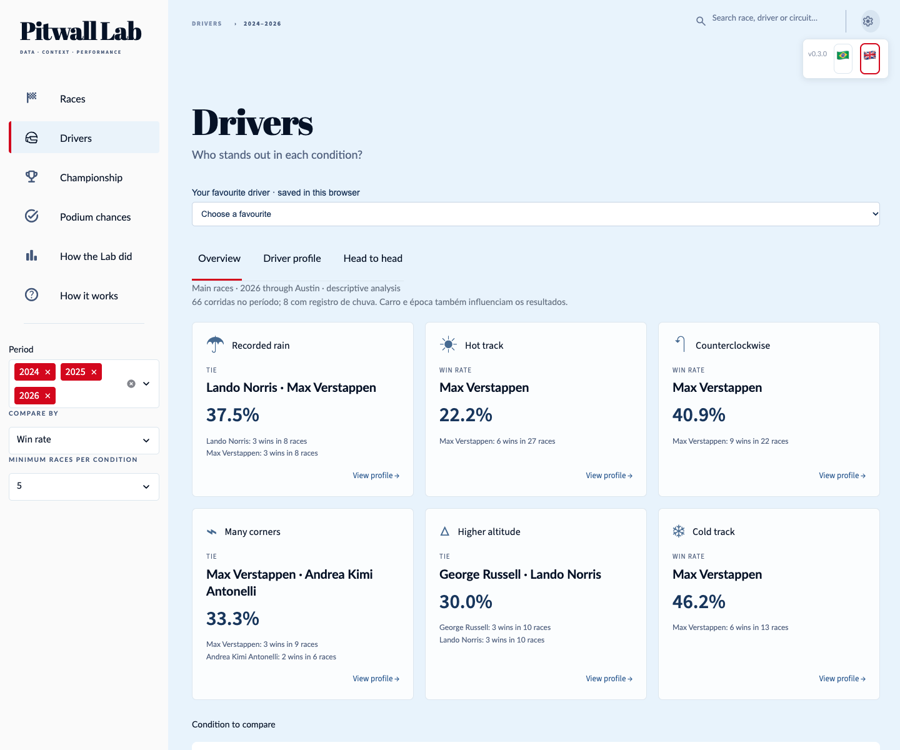

# Pitwall Lab

**[Português](README.md) · English**

A Formula 1 data-science portfolio by **MBPaschoal**. I am learning to build a complete product: collect data, recognise its limitations, evaluate a model and turn results into a clear interface. Corrections and inconclusive findings are part of that journey.

**[Open the dashboard](https://pitwall-lab.streamlit.app/) · [Learning journal](docs/en/LEARNING.md) · [Versions](CHANGELOG.en.md) · [Architecture](docs/en/ARCHITECTURE.md)**

Who wins more often in the rain? How do two drivers compare at the same races? Who has done well at this circuit? Explore these questions using the filters; car and era also affect results.




Mexico 2026 preparation: five-session tracking, explicit sources and times, collection after observed finishes and forecasts separated from race observations. [Operation and limits](docs/en/WEEKEND_OPERATION.md). This publication does not yet contain Mexico results or a prospective Mexico forecast.

## The product today

- **Drivers:** condition leaders, profiles, shared-race duels, a browser-local favourite and shareable cards, with explicit sample sizes and ties. [Data audit](reports/pilotos_condicoes_20261029/README.en.md).
- **Races:** results, circuit profile, session times, weather, tyres/stops, teams and driver performance in up to five previous editions at the same circuit.
- **Championship:** full driver and constructor standings at the selected round.
- **Podium chances:** individual podium probabilities and subsequent comparison. Austin 2026's prospective recorded prediction remains separate from the retrospective study.
- **How the Lab did:** log loss, Brier, calibration, ranking and coverage with explicit denominators.
- **How it works:** offline documents and reports. The 🇧🇷 and 🇬🇧 flags in the upper-right corner select Portuguese or English and retain the current navigation.

The descriptive archive covers **66 GPs and 330 sessions in 2024–2026 through Austin**. Drivers uses 1,340 starts, sensors within actual racing intervals and edition-specific FIA maps. The audit records 295 checks; 17 practice/qualifying compounds remain missing and do not enter these rankings. History compares earlier editions at the same circuit. [Corrections and limits](docs/en/CURRENT_DATA.md).

## What I learned from mistakes

Displaying a number is not enough: I need to explain its origin, when it could have been available and what it means. History initially showed the current race; it now answers the question about previous editions at the same circuit. Incomplete rankings now disclose missing data without inventing positions or zero scores. Publication gained its own verification because a local test does not prove what Streamlit serves.

The [learning journal](docs/en/LEARNING.md) connects lessons to changes and verification. I do not invent retrospective versions or rewrite commits to make development appear error-free.

## Scientific result and limitations

**Model v1 is frozen:** logistic regression, training on 2021–2023, previously explored 2024 validation and completed retrospective 2025 evaluation. Across the same 22 evaluable 2025 GPs, the model identified 51 podium drivers versus qualifying's 50; both identified all three in 8/22 GPs. These are descriptive findings, without demonstrated significance or future guarantees.

The model does not predict P1/P2/P3 order. Individual probabilities are not forced to sum to three. Historical sources may contain post-cutoff revisions. **2025 is no longer untouched testing**, and research v2 has not been promoted. New display data do not change the 15 inputs, model or recorded probabilities.

## Run and find the code

The entry point remains `app.py`. Implementation lives in [`pitwall/`](pitwall/), organised by blueprint responsibility. Small root modules preserve existing imports/commands; frozen scientific producers retain their original paths.

Using the existing analysis environment:

```bash
./.venv/bin/python -m streamlit run app.py --server.address 127.0.0.1 --server.port 8501
```

For an independent presentation installation, use Python 3.12 and the [portable-package instructions](distribuicao/pitwall-dashboard/README.en.md). Navigation does not collect data, train or run inference. Cloud uses `distribuicao/pitwall-dashboard/app.py` on `main`.

## Versions and contribution

[`VERSION`](VERSION) identifies the product, **not** the model. Every delivered data update or improvement requires a new version, Portuguese/English notes and validation evidence. The policy starts at **0.1.0**, without invented earlier versions. See the [version policy](docs/en/VERSIONS.md) and [contribution guide](CONTRIBUTING.en.md).

- [Portuguese/English technical documentation](docs/README.md)
- [Sources, attribution and limitations](publicacao/templates/FONTES_E_DADOS.md)
- [Model v1 method](docs/en/experimento_modelo_v1.md) · [Português](docs/experimento_modelo_v1.md)
- [Temporal protocol](docs/en/protocolo_temporal.md) · [Português](docs/protocolo_temporal.md)

Different sources retain their own conditions; one licence does not automatically extend to another source. Original code is licensed under MIT; third-party source conditions remain separate. Independent educational project without official affiliation to Formula 1, data sources or teams.

Original code is available under the [MIT License](LICENSE). Third-party data and assets retain their own terms.

- [Delivery of the 45 critical review items](docs/en/REVIEW_030.md)
