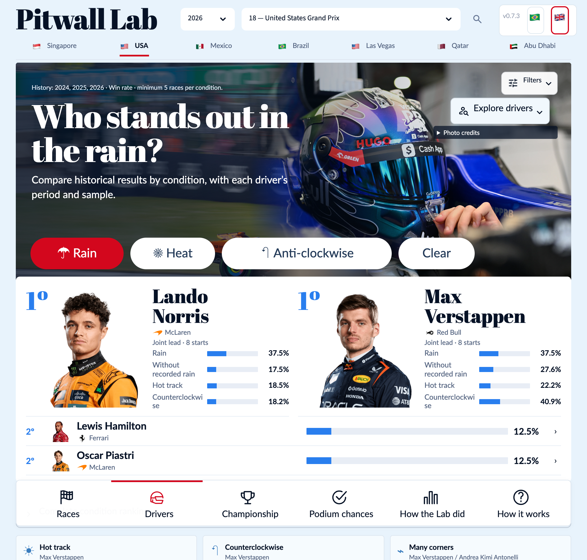

# Pitwall Lab

**[Português](README.md) · English**

A Formula 1 data-science portfolio by **MBPaschoal**. Pitwall Lab started with analyses in Python and grew into a bilingual dashboard that shows what happened on track, what the model estimated before the start, and how those estimates were evaluated.

**[Open the dashboard](https://pitwall-lab.streamlit.app/) · [Learning journal](docs/en/LEARNING.md) · [Versions](CHANGELOG.en.md) · [Architecture](docs/en/ARCHITECTURE.md)**

## Three-screen demo

1. See the observed result of São Paulo 2026 and explore sessions, tyres and stops for the same GP. [Interlagos race result](https://pitwall-lab.streamlit.app/?tela=Corridas&temporada=2026&gp=20&lang=en)
2. Open the GP Cards and reveal individual podium chances recorded after qualifying. The cards give each driver's probability of finishing in the top three. [Interlagos forecast](https://pitwall-lab.streamlit.app/?tela=Previs%C3%B5es&temporada=2026&gp=20&lang=en)
3. Open a profile and select a grid position to see the change from start to finish, the sample size and the races behind it. [Max Verstappen's profile](https://pitwall-lab.streamlit.app/?tela=Pilotos&visao=perfil&piloto=max_verstappen&temporada=2026&gp=20&lang=en)



## How the project evolved

| Stage | What changed |
| --- | --- |
| Collection and analysis | Season analyses became a reproducible archive with source, retrieval time, coverage and identity checks. [Sources and data](docs/en/CURRENT_DATA.md) |
| Modelling and evaluation | The v1 logistic regression gained a temporal cutoff, a qualifying baseline and evaluation with Brier score, log loss and calibration. Later candidates stayed in research. [Method](docs/en/experimento_modelo_v1.md) · [Temporal protocol](docs/en/protocolo_temporal.md) |
| Bilingual product | Races, Drivers, Championship and Forecasts gained task-based navigation with GP context, editorial artwork and browser tests in Chromium and WebKit. [Fan Journey](docs/en/FAN_JOURNEY.md) · [PR #32](https://github.com/mbpaschoal/pitwall-lab/pull/32) |
| Operations and publication | GitHub Actions collects sessions, validates them and publishes changes. The package, data and served version have separate checks. A prospective forecast requires evidence from before lights out. [Automation](docs/en/AUTOMATION.md) · [Workflow runs](https://github.com/mbpaschoal/pitwall-lab/actions/workflows/coletar-dados.yml) |
| Grid-position comparisons | Driver profiles now show the change from start to finish by starting position, with sample size and underlying races. [PR #34](https://github.com/mbpaschoal/pitwall-lab/pull/34) |
| Next GP | Las Vegas entered the post-qualifying workflow. A forecast requires observed Q3 and a review of the official 22-car entry list. [PR #35](https://github.com/mbpaschoal/pitwall-lab/pull/35) |

## The product today

- **Drivers:** condition leaders, profiles, shared-race duels, a browser-local favourite and shareable cards, with explicit sample sizes and ties. [Data audit](reports/pilotos_condicoes_20261029/README.en.md).
- **Races:** results, circuit profile, session times, weather, tyres/stops, teams and driver performance in up to five previous editions at the same circuit.
- **Championship:** full driver and constructor standings at the selected round.
- **Podium chances:** individual probabilities and subsequent comparison. The 2026 Austin and São Paulo forecasts have their own records, separate from the retrospective study.
- **How the Lab did:** log loss, Brier, calibration, ranking and coverage with explicit denominators.
- **How it works:** offline documents and reports. The 🇧🇷 and 🇬🇧 flags in the upper-right corner select Portuguese or English and retain the current navigation.

The descriptive baseline covers **66 GPs and 330 sessions in 2024–2026 through Austin**. With the Mexico and São Paulo supplements, Drivers covers **68 GPs, 1,398 results and 1,383 starts**. Analyses use sensors within actual racing intervals and edition-specific FIA maps. The interface shows the period covered by each view. [Corrections, coverage and limits](docs/en/CURRENT_DATA.md)

## What I learned from mistakes

Displaying a number is not enough: I need to explain its origin, when it could have been available and what it means. History initially showed the current race; it now answers the question about previous editions at the same circuit. Incomplete rankings now disclose missing data without inventing positions or zero scores. Publication gained its own verification because a local test does not prove what Streamlit serves.

The [learning journal](docs/en/LEARNING.md) connects lessons to changes and verification. I do not invent retrospective versions or rewrite commits to make development appear error-free.

## Scientific result and limitations

**Model v1 is frozen:** logistic regression, training on 2021–2023, previously explored 2024 validation and completed retrospective 2025 evaluation. Across the same 22 evaluable 2025 GPs, the model identified 51 podium drivers versus qualifying's 50; both identified all three in 8/22 GPs. These are descriptive findings, without demonstrated significance or future guarantees.

The model does not predict P1/P2/P3 order. Individual probabilities are not forced to sum to three. Historical sources may contain post-cutoff revisions. **2025 is no longer untouched testing**, and research v2 has not been promoted. New display data do not change the 15 inputs, model or recorded probabilities.

## Run and find the code

The entry point remains `app.py`. Implementation lives in [`pitwall/`](pitwall/), organised by blueprint responsibility. Small root modules preserve existing imports/commands; frozen scientific producers retain their original paths.

Using the existing analysis environment:

```bash
./.venv/bin/python -m streamlit run app.py --server.address 127.0.0.1 --server.port 8501
```

For an independent presentation installation, use Python 3.12 and the [portable-package instructions](distribuicao/pitwall-dashboard/README.en.md). Navigation does not collect data, train or run inference. Cloud uses `distribuicao/pitwall-dashboard/app.py` on `main`.

## Versions and contribution

[`VERSION`](VERSION) identifies the product, **not** the model. Every delivered data update or improvement requires a new version, Portuguese/English notes and validation evidence. The policy starts at **0.1.0**, without invented earlier versions. See the [version policy](docs/en/VERSIONS.md) and [contribution guide](CONTRIBUTING.en.md).

- [Portuguese/English technical documentation](docs/README.md)
- [Sources, attribution and limitations](publicacao/templates/FONTES_E_DADOS.md)
- [Model v1 method](docs/en/experimento_modelo_v1.md) · [Português](docs/experimento_modelo_v1.md)
- [Temporal protocol](docs/en/protocolo_temporal.md) · [Português](docs/protocolo_temporal.md)

Different sources retain their own conditions; one licence does not automatically extend to another source. Original code is licensed under MIT; third-party source conditions remain separate. Independent educational project without official affiliation to Formula 1, data sources or teams.

Original code is available under the [MIT License](LICENSE). Third-party data and assets retain their own terms.

- [Delivery of the 45 critical review items](docs/en/REVIEW_030.md)

[Security and private reporting](SECURITY.md) · [Controls and limits](docs/en/SECURITY.md)

Complementary sources: [offline F1DB/Pirelli integration](docs/en/COMPLEMENTARY_SOURCES.md), with field provenance and documentary admission separated from the model.
