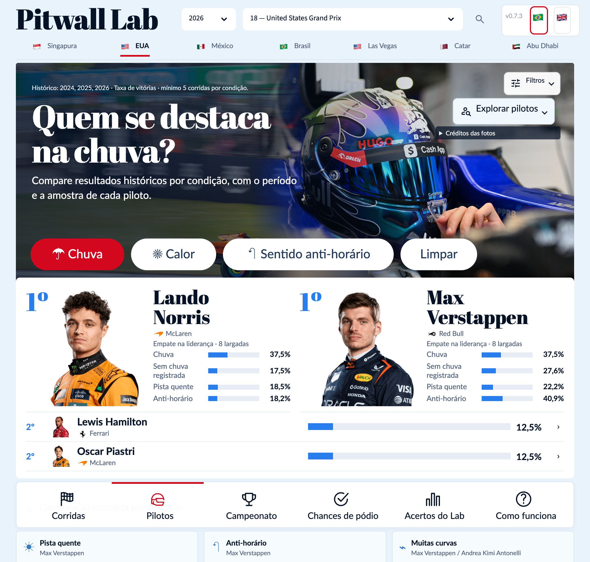

# Pitwall Lab

**Português · [English](README.en.md)**

Portfólio de ciência de dados sobre Fórmula 1, criado por **MBPaschoal**. O Pitwall Lab começou com análises em Python e evoluiu para um painel bilíngue que reúne o que aconteceu na pista, o que o modelo estimou antes da largada e como essas estimativas foram avaliadas.

**[Abrir o dashboard](https://pitwall-lab.streamlit.app/) · [Evolução e aprendizados](docs/APRENDIZADOS.md) · [Versões](CHANGELOG.md) · [Arquitetura](docs/ARQUITETURA.md)**

## Demonstração em três telas

1. Veja o resultado observado de São Paulo 2026 e abra as sessões, os pneus e as paradas do mesmo GP. [Resultado em Interlagos](https://pitwall-lab.streamlit.app/?tela=Corridas&temporada=2026&gp=20&lang=pt)
2. Abra as Cartas do GP e revele as chances individuais de pódio registradas após a classificação. As cartas mostram probabilidades de terminar entre os três primeiros. [Previsão de Interlagos](https://pitwall-lab.streamlit.app/?tela=Previs%C3%B5es&temporada=2026&gp=20&lang=pt)
3. Abra um perfil e escolha uma posição de largada para ver o saldo até a chegada, o tamanho da amostra e as corridas que sustentam o recorte. [Perfil de Max Verstappen](https://pitwall-lab.streamlit.app/?tela=Pilotos&visao=perfil&piloto=max_verstappen&temporada=2026&gp=20&lang=pt)



## Como o projeto evoluiu

| Etapa | O que mudou |
| --- | --- |
| Coleta e análise | As análises da temporada deram lugar a um acervo reproduzível com origem, horário, cobertura e conferência de identidade. [Fontes e dados](docs/DADOS_ATUAIS.md) |
| Modelo e avaliação | A regressão logística v1 ganhou corte temporal, comparação com a classificação e avaliação por Brier, log loss e calibração. Candidatos posteriores ficaram em pesquisa. [Método](docs/experimento_modelo_v1.md) · [Protocolo temporal](docs/protocolo_temporal.md) |
| Produto bilíngue | Corridas, Pilotos, Campeonato e Previsões ganharam rotas próprias com contexto de GP, visual editorial e testes de navegação em Chromium e WebKit. [Jornada do fã](docs/JORNADA_DO_FA.md) · [PR #32](https://github.com/mbpaschoal/pitwall-lab/pull/32) |
| Operação e publicação | O GitHub Actions coleta novas sessões, valida e publica mudanças. Pacote, dados e versão servida são conferidos separadamente. A previsão prospectiva exige evidência anterior à largada. [Automação](docs/AUTOMACAO.md) · [Execuções](https://github.com/mbpaschoal/pitwall-lab/actions/workflows/coletar-dados.yml) |
| Comparação por largada | O perfil passou a detalhar a diferença entre largada e chegada, com recorte por posição, amostra e corridas consultáveis. [PR #34](https://github.com/mbpaschoal/pitwall-lab/pull/34) |
| Próximo GP | Las Vegas entrou no fluxo de previsão pós-classificação. A emissão depende do Q3 observado e da revisão da lista oficial dos 22 inscritos. [PR #35](https://github.com/mbpaschoal/pitwall-lab/pull/35) |

## O produto hoje

- **Pilotos:** destaques por condição, perfil, duelos, favorito no navegador e cartões para compartilhar. Filtros, amostras e empates ficam explícitos. [Auditoria dos dados](reports/pilotos_condicoes_20261029/README.md).
- **Corridas:** resultado, ficha do circuito, tempos, clima, pneus/paradas, equipes e desempenho dos pilotos em até cinco edições anteriores na mesma pista.
- **Campeonato:** classificação completa de pilotos e equipes na rodada selecionada.
- **Chances de pódio:** probabilidades individuais e comparação posterior. As emissões de Austin e São Paulo de 2026 têm registros próprios, separados do estudo retrospectivo.
- **Acertos do Lab:** log loss, Brier, calibração, ranking e cobertura, com denominadores explícitos.
- **Como funciona:** documentos e relatórios offline. As bandeiras 🇧🇷 e 🇬🇧 no canto superior direito selecionam português ou inglês e acompanham a navegação.

O acervo descritivo parte de **66 GPs e 330 sessões de 2024–2026 até Austin**. Com os complementos de México e São Paulo, Pilotos cobre **68 GPs, 1.398 resultados e 1.383 largadas**. As análises usam sensores nos intervalos efetivos e mapas FIA de cada edição. A tela informa o período de cada recorte. [Correções, cobertura e limites](docs/DADOS_ATUAIS.md)

## O que aprendi com os erros

Um número exibido não basta: preciso explicar de onde veio, quando poderia estar disponível e o que significa. O Histórico inicialmente mostrava a corrida atual; agora responde à pergunta sobre edições anteriores da mesma pista. Rankings incompletos passaram a declarar a ausência, sem criar posições ou pontuações zero. A publicação ganhou uma verificação própria porque um teste local não comprova o que está no Streamlit.

O [diário de evolução](docs/APRENDIZADOS.md) liga cada aprendizado a uma mudança e a uma verificação. Não atribuo versões retroativas nem reescrevo os commits para aparentar um desenvolvimento sem erros.

## Resultado científico e limites

O **modelo v1 está congelado**: regressão logística, treino em 2021–2023, validação de 2024 já explorada e avaliação retrospectiva de 2025 já realizada. Em 2025, nos mesmos 22 GPs avaliáveis, o modelo identificou 51 integrantes do pódio e a classificação 50; ambos acertaram os três em 8/22 GPs. São resultados descritivos, sem demonstração de significância ou garantia futura.

O modelo não prevê a ordem P1/P2/P3. As probabilidades individuais não são forçadas a somar três. Fontes históricas podem conter revisões posteriores ao corte. **2025 não é mais teste intocado**, e a pesquisa v2 ainda não foi promovida. Dados novos de interface não alteram as 15 entradas, o modelo ou as probabilidades registradas.

## Executar e encontrar o código

O ponto de entrada continua sendo `app.py`. A implementação está no pacote [`pitwall/`](pitwall/), separado pelas responsabilidades do blueprint. Os pequenos módulos da raiz preservam imports/comandos existentes; os produtores científicos congelados mantêm seus caminhos originais.

Para usar o ambiente de análise existente:

```bash
./.venv/bin/python -m streamlit run app.py --server.address 127.0.0.1 --server.port 8501
```

Para uma instalação de apresentação independente, use Python 3.12 e as instruções do [pacote portátil](distribuicao/pitwall-dashboard/README.md). A navegação não coleta dados, treina ou executa inferência. O Cloud usa `distribuicao/pitwall-dashboard/app.py` na branch `main`.

## Versões e contribuição

[`VERSION`](VERSION) identifica o produto; **não** é a versão do modelo. Cada atualização de dados ou melhoria entregue exige nova versão, notas em português/inglês e evidências de validação. A política começa em **0.1.0**, sem inventar versões anteriores. Consulte a [política de versões](docs/VERSOES.md) e o [guia de contribuição](CONTRIBUTING.md).

- [Documentação técnica em português e inglês](docs/README.md)
- [Fontes, atribuição e limites](publicacao/templates/FONTES_E_DADOS.md)
- [Método v1](docs/experimento_modelo_v1.md) · [English](docs/en/experimento_modelo_v1.md)
- [Protocolo temporal](docs/protocolo_temporal.md) · [English](docs/en/protocolo_temporal.md)

Dados de fontes diferentes conservam suas próprias condições; nenhuma licença é estendida automaticamente a outra fonte. O código original está sob a [licença MIT](LICENSE); os materiais de terceiros mantêm seus próprios termos. Projeto educacional independente, sem vínculo oficial com Fórmula 1, fontes ou equipes.

- [Entrega dos 45 itens da revisão crítica](docs/REVISAO_030.md)

[Segurança e relato privado](SECURITY.md) · [Controles e limites](docs/SEGURANCA.md)

Fontes complementares: [integração offline F1DB/Pirelli](docs/FONTES_COMPLEMENTARES.md), com procedência por campo e admissão documental separada do modelo.
