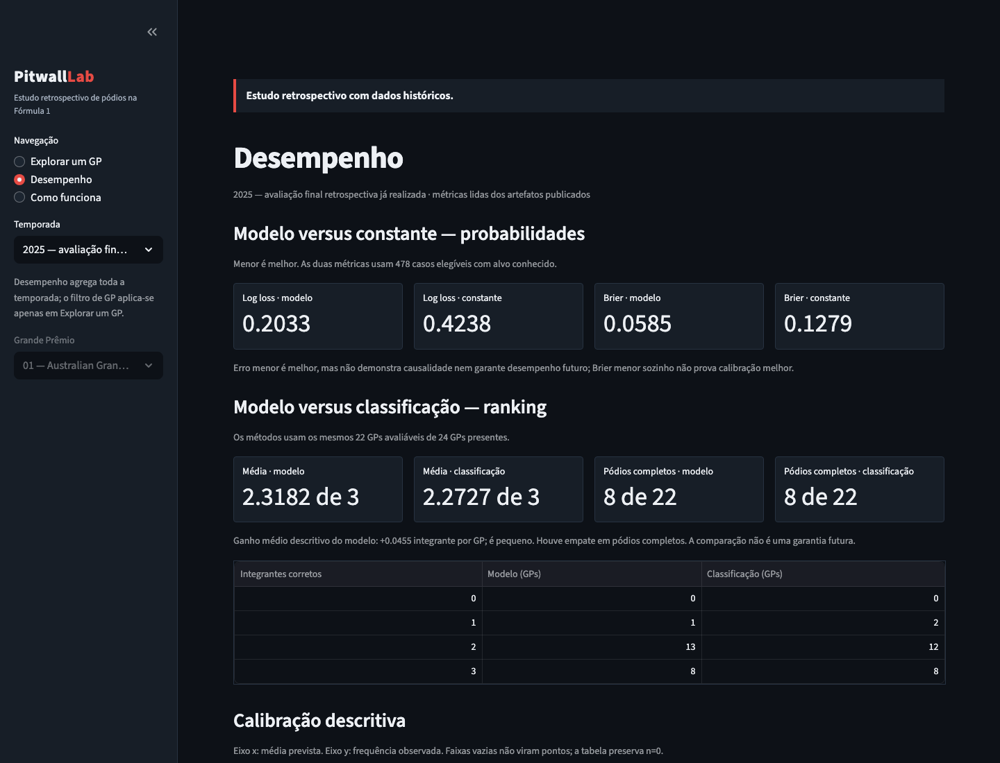

# Pitwall Lab — dashboard retrospectivo de pódios na Fórmula 1

Demonstração local e publicável de um estudo retrospectivo sobre a probabilidade
individual de um piloto integrar o pódio de um Grande Prêmio principal. Não é uma
previsão ao vivo, não estima a ordem do pódio e não consulta fontes na execução.



## Três telas

- **Explorar um GP:** probabilidades já calculadas, favoritos publicados,
  cobertura e resultados posteriores mantidos separados.
- **Desempenho:** métricas probabilísticas, ranking, calibração e cobertura por
  Grande Prêmio.
- **Como funciona:** método, documentos e relatórios renderizados dentro da
  própria interface, além de downloads dos CSVs que acompanham a demonstração.

## Arquitetura simples

`app.py` apresenta o dashboard em Streamlit e Plotly. `dashboard_dados.py` lê e
valida apenas nove CSV/JSON de resultados. `documentacao_local.py` oferece uma
allowlist de documentação offline; ele não abre caminhos arbitrários nem baixa
conteúdo. Não há joblib, scikit-learn, treinamento, inferência, coletor, API de
dados ou dados brutos neste pacote.

## Fonte, método e resultados

Os dados derivam de Jolpica-F1; veja [FONTES_E_DADOS.md](FONTES_E_DADOS.md).
O estudo usa regressão logística treinada em 2021–2023; 2024 foi uma validação já
explorada e 2025 uma avaliação retrospectiva já realizada. A classificação é uma
referência de ranking, não uma probabilidade. As limitações temporais e de fonte
estão nos documentos exibidos pela interface e em `docs/`.

Em 2025, as métricas probabilísticas usam 478 casos. Nos mesmos
22 GPs avaliáveis de ranking, o modelo identificou 51
integrantes de pódio, contra 50 da classificação. A
média foi 2.3182 contra 2.2727; ambos
acertaram os três integrantes em 8/22 GPs. É uma
vantagem descritiva pequena e um empate em pódios completos, não evidência de
garantia futura, causalidade ou significância estatística.

2025 já foi avaliado para o v1: não é teste intocado para versões posteriores.
As fontes históricas podem ter revisões posteriores ao corte; o estudo não prova
que cada previsão foi registrada antes de cada corrida.

## Executar localmente

Use Python 3.12 em um ambiente novo, criado dentro desta distribuição pública;
isso não modifica o ambiente científico original:

```bash
python3.12 -m venv .venv
. .venv/bin/activate
python -m pip install --upgrade pip
python -m pip install -r requirements.txt
python -m streamlit run app.py --server.address 127.0.0.1 --server.port 8501
```

Abra `http://127.0.0.1:8501`. O endereço e a porta desse comando são uma escolha
local; não são configuração de hospedagem pública.

Para executar a suíte da distribuição:

```bash
python -m unittest discover -s tests -v
```

## Hospedagem futura, ainda não executada

Crie um repositório **público separado**, fora deste cofre, e copie somente os
arquivos listados em `ARQUIVOS_PUBLICACAO.txt`. Nesse novo diretório, inicie um
histórico novo com `git init`, crie a branch `main` e revise a lista antes de
adicionar arquivos. Nunca publique o histórico deste repositório/cofre atual.

No Streamlit Community Cloud, selecione o repositório novo, a branch `main` e
`app.py`; em **Advanced settings**, selecione Python 3.12. Não há secrets
necessários para este pacote. As instruções detalhadas e limitações estão em
[GUIA_HOSPEDAGEM.md](GUIA_HOSPEDAGEM.md). Não há URL de aplicativo ou badge de
deploy porque a publicação ainda não foi feita.

## Licenças e limites

A licença aberta do código ainda não foi definida; consulte
[LICENCA_CODIGO.md](LICENCA_CODIGO.md). Essa pendência não altera as condições dos
dados, que estão em [FONTES_E_DADOS.md](FONTES_E_DADOS.md). Hospedagem gratuita
não transforma o código automaticamente em código aberto.
