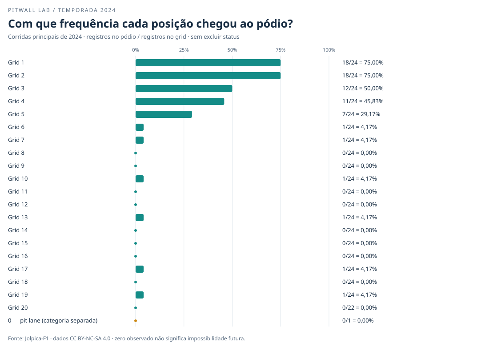
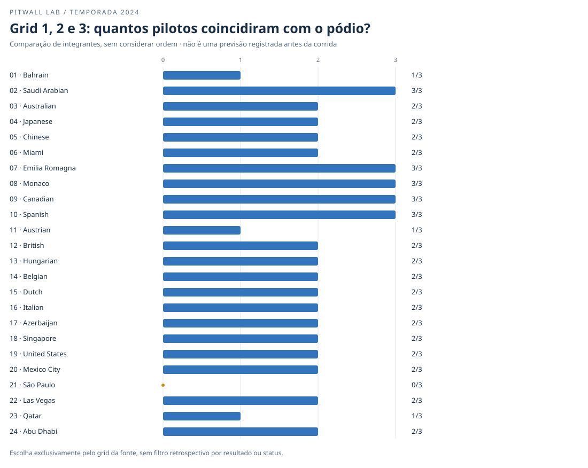
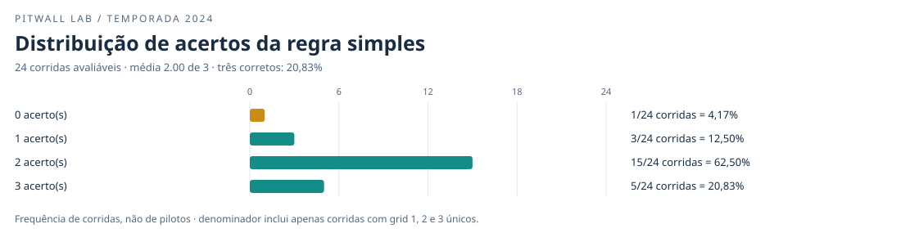

# Pitwall Lab — temporada 2024: grid e pódio

## 1. O que foi construído e como reproduzir

Coleta das **corridas principais**, sem sprints. Uma linha por piloto e corrida, com os identificadores estáveis da fonte. Somente biblioteca padrão do Python; nenhuma dependência nova, modelo ou dashboard.

Dentro da pasta do projeto, execute:

```bash
./.venv/bin/python coletar_temporada.py
./.venv/bin/python analisar_temporada.py
./.venv/bin/python -m unittest discover -s tests -v
```

O calendário vem de `/2024/` e os resultados de `/2024/results/`, com `limit=100` e `offset` avançando pela quantidade recebida. O calendário válido da etapa 1 foi reaproveitado. Os JSON originais ficam em `data/temporada_2024/raw/`; CSV e comprovante de completude ficam em `data/temporada_2024/`. As respostas são um retrato versionado, não uma atualização automática da API.

Cada página é validada antes de ser gravada; total, limite e offset precisam ser coerentes. Uma corrida pode atravessar páginas. O CSV final só é produzido após a conferência de todas as páginas, corridas, chaves e pódios. A análise não acessa a rede: reconstrói os dados do cache e confere CSV, comprovante e hashes. Conteúdo existente diferente não é sobrescrito; um erro não transforma caches parciais em base completa.

Aplicativo `PitwallLab/0.2.0`, com versão do Python no User-Agent. Requisições sequenciais espaçadas por pelo menos 8 segundos. Limites documentados consultados: 4/s e 500/h, compartilhados pelo IP e sujeitos a alterações. HTTP 429 encerra a coleta e informa Retry-After; não há repetição automática. Não execute coletores simultaneamente.

## 2. Verificação da base

| Verificação | Resultado |
| --- | --- |
| Corridas esperadas pelo calendário | 24 |
| Corridas coletadas | 24 |
| Registros | 479 |
| Duplicações temporada/rodada/piloto | 0 |
| Total de campos ausentes | 0 |
| Corridas avaliáveis para a regra | 24/24 |

### Registros e pódios por corrida

| Rodada | Corrida | Registros | Pilotos no pódio |
| --- | --- | --- | --- |
| 1 | Bahrain Grand Prix | 20 | 3 |
| 2 | Saudi Arabian Grand Prix | 20 | 3 |
| 3 | Australian Grand Prix | 19 | 3 |
| 4 | Japanese Grand Prix | 20 | 3 |
| 5 | Chinese Grand Prix | 20 | 3 |
| 6 | Miami Grand Prix | 20 | 3 |
| 7 | Emilia Romagna Grand Prix | 20 | 3 |
| 8 | Monaco Grand Prix | 20 | 3 |
| 9 | Canadian Grand Prix | 20 | 3 |
| 10 | Spanish Grand Prix | 20 | 3 |
| 11 | Austrian Grand Prix | 20 | 3 |
| 12 | British Grand Prix | 20 | 3 |
| 13 | Hungarian Grand Prix | 20 | 3 |
| 14 | Belgian Grand Prix | 20 | 3 |
| 15 | Dutch Grand Prix | 20 | 3 |
| 16 | Italian Grand Prix | 20 | 3 |
| 17 | Azerbaijan Grand Prix | 20 | 3 |
| 18 | Singapore Grand Prix | 20 | 3 |
| 19 | United States Grand Prix | 20 | 3 |
| 20 | Mexico City Grand Prix | 20 | 3 |
| 21 | São Paulo Grand Prix | 20 | 3 |
| 22 | Las Vegas Grand Prix | 20 | 3 |
| 23 | Qatar Grand Prix | 20 | 3 |
| 24 | Abu Dhabi Grand Prix | 20 | 3 |

**Diferença investigada:** a Austrália tem 19 registros, não 20. O comunicado da Williams explica que, após o acidente de Albon e sem um terceiro chassi, ele usou o carro de Sargeant; Sargeant foi retirado do restante do fim de semana. O resultado da API tem Albon e não tem Sargeant. Não foi inventada uma linha para preencher a contagem. As outras corridas têm 20 registros nesta extração, mas o coletor não impõe 20 como regra: confere o total da API e o calendário.

O contexto da Williams é informação externa documentada, não uma causa deduzida do CSV. Os links estão ao final.

### Campos ausentes

| Campo | Ausentes |
| --- | --- |
| temporada | 0 |
| rodada | 0 |
| corrida | 0 |
| data_corrida | 0 |
| circuito_id | 0 |
| circuito | 0 |
| piloto_id | 0 |
| piloto | 0 |
| equipe_id | 0 |
| equipe | 0 |
| posicao_largada | 0 |
| posicao_final | 0 |
| status | 0 |
| pontos | 0 |
| podio | 0 |

### Status: nenhum registro foi excluído

| Status | Registros | Proporção da base |
| --- | --- | --- |
| Did not start | 3 | 0,63% |
| Disqualified | 2 | 0,42% |
| Finished | 287 | 59,92% |
| Lapped | 138 | 28,81% |
| Retired | 49 | 10,23% |

`Finished` indica que terminou; `Lapped`, que terminou com volta(s) de atraso; `Retired`, abandono; `Did not start`, não largada; `Disqualified`, desclassificação. Uma posição numérica não basta para concluir que o piloto completou a prova. Mantivemos os status e não usamos o resultado ou o status final para escolher favoritos.

## 3. Frequência de pódio por posição de largada

Frequência observada = registros de pódio naquela posição / todos os registros daquela posição. Os denominadores incluem não largadas, abandonos e desclassificações: são posições de grid **registradas na fonte**, não uma contagem de largadas efetivas. O indicador `podio` é 1 exatamente quando a posição final está entre 1 e 3; não depende de pontos ou status.



| Grid registrado | Registros (n) | Pódios | Pódios / n |
| --- | --- | --- | --- |
| 1 | 24 | 18 | 75,00% |
| 2 | 24 | 18 | 75,00% |
| 3 | 24 | 12 | 50,00% |
| 4 | 24 | 11 | 45,83% |
| 5 | 24 | 7 | 29,17% |
| 6 | 24 | 1 | 4,17% |
| 7 | 24 | 1 | 4,17% |
| 8 | 24 | 0 | 0,00% |
| 9 | 24 | 0 | 0,00% |
| 10 | 24 | 1 | 4,17% |
| 11 | 24 | 0 | 0,00% |
| 12 | 24 | 0 | 0,00% |
| 13 | 24 | 1 | 4,17% |
| 14 | 24 | 0 | 0,00% |
| 15 | 24 | 0 | 0,00% |
| 16 | 24 | 0 | 0,00% |
| 17 | 24 | 1 | 4,17% |
| 18 | 24 | 0 | 0,00% |
| 19 | 24 | 1 | 4,17% |
| 20 | 22 | 0 | 0,00% |
| 0 — pit lane | 1 | 0 | 0,00% |

### Grid zero, separado

A documentação Jolpica descreve `grid` e remete à documentação Ergast para lacunas. No contrato original, **zero indica largada do pit lane**, não uma posição melhor que a pole. Nesta extração o único zero é Ocon no México; a notícia oficial da F1 confirma a largada do pit lane. Um único registro não permite estimar uma chance confiável para todas as largadas do pit lane. Não recodificamos outros valores nem presumimos que todo caso real de pit lane esteja codificado como zero na fonte.

## 4. Quanto do pódio veio do top 3 do grid?

**48/72 pódios = 66,67%** vieram de pilotos com grid registrado 1, 2 ou 3. O denominador aqui é o total de vagas no pódio, não o total de pilotos da temporada.

## 5. Referência retrospectiva: escolher grid 1, 2 e 3

Escolhemos os pilotos unicamente pelo grid registrado, inclusive se depois abandonaram, não largaram ou foram desclassificados. Comparamos identificadores de pilotos como conjuntos: a ordem de chegada não afeta o número de acertos. Não substituímos um favorito por outro depois de observar o resultado.

**Média: 48 acertos / 24 corridas avaliáveis = 2.00 de 3 por corrida.** Os três integrantes corretos ocorreram em **5/24 corridas = 20,83%**.





| Acertos (sem ordem) | Corridas | Proporção das avaliáveis |
| --- | --- | --- |
| 0 | 1 | 4,17% |
| 1 | 3 | 12,50% |
| 2 | 15 | 62,50% |
| 3 | 5 | 20,83% |

### Escolhidos e pódio real em cada corrida

| Rodada | Corrida | Escolhidos (ordem do grid) | Pódio real (ordem final) | Acertos / 3 | Problemas do grid |
| --- | --- | --- | --- | --- | --- |
| 1 | Bahrain Grand Prix | Max Verstappen; Charles Leclerc; George Russell | Max Verstappen; Sergio Pérez; Carlos Sainz | 1 | nenhum |
| 2 | Saudi Arabian Grand Prix | Max Verstappen; Charles Leclerc; Sergio Pérez | Max Verstappen; Sergio Pérez; Charles Leclerc | 3 | nenhum |
| 3 | Australian Grand Prix | Max Verstappen; Carlos Sainz; Lando Norris | Carlos Sainz; Charles Leclerc; Lando Norris | 2 | nenhum |
| 4 | Japanese Grand Prix | Max Verstappen; Sergio Pérez; Lando Norris | Max Verstappen; Sergio Pérez; Carlos Sainz | 2 | nenhum |
| 5 | Chinese Grand Prix | Max Verstappen; Sergio Pérez; Fernando Alonso | Max Verstappen; Lando Norris; Sergio Pérez | 2 | nenhum |
| 6 | Miami Grand Prix | Max Verstappen; Charles Leclerc; Carlos Sainz | Lando Norris; Max Verstappen; Charles Leclerc | 2 | nenhum |
| 7 | Emilia Romagna Grand Prix | Max Verstappen; Lando Norris; Charles Leclerc | Max Verstappen; Lando Norris; Charles Leclerc | 3 | nenhum |
| 8 | Monaco Grand Prix | Charles Leclerc; Oscar Piastri; Carlos Sainz | Charles Leclerc; Oscar Piastri; Carlos Sainz | 3 | nenhum |
| 9 | Canadian Grand Prix | George Russell; Max Verstappen; Lando Norris | Max Verstappen; Lando Norris; George Russell | 3 | nenhum |
| 10 | Spanish Grand Prix | Lando Norris; Max Verstappen; Lewis Hamilton | Max Verstappen; Lando Norris; Lewis Hamilton | 3 | nenhum |
| 11 | Austrian Grand Prix | Max Verstappen; Lando Norris; George Russell | George Russell; Oscar Piastri; Carlos Sainz | 1 | nenhum |
| 12 | British Grand Prix | George Russell; Lewis Hamilton; Lando Norris | Lewis Hamilton; Max Verstappen; Lando Norris | 2 | nenhum |
| 13 | Hungarian Grand Prix | Lando Norris; Oscar Piastri; Max Verstappen | Oscar Piastri; Lando Norris; Lewis Hamilton | 2 | nenhum |
| 14 | Belgian Grand Prix | Charles Leclerc; Sergio Pérez; Lewis Hamilton | Lewis Hamilton; Oscar Piastri; Charles Leclerc | 2 | nenhum |
| 15 | Dutch Grand Prix | Lando Norris; Max Verstappen; Oscar Piastri | Lando Norris; Max Verstappen; Charles Leclerc | 2 | nenhum |
| 16 | Italian Grand Prix | Lando Norris; Oscar Piastri; George Russell | Charles Leclerc; Oscar Piastri; Lando Norris | 2 | nenhum |
| 17 | Azerbaijan Grand Prix | Charles Leclerc; Oscar Piastri; Carlos Sainz | Oscar Piastri; Charles Leclerc; George Russell | 2 | nenhum |
| 18 | Singapore Grand Prix | Lando Norris; Max Verstappen; Lewis Hamilton | Lando Norris; Max Verstappen; Oscar Piastri | 2 | nenhum |
| 19 | United States Grand Prix | Lando Norris; Max Verstappen; Carlos Sainz | Charles Leclerc; Carlos Sainz; Max Verstappen | 2 | nenhum |
| 20 | Mexico City Grand Prix | Carlos Sainz; Max Verstappen; Lando Norris | Carlos Sainz; Lando Norris; Charles Leclerc | 2 | nenhum |
| 21 | São Paulo Grand Prix | Lando Norris; George Russell; Yuki Tsunoda | Max Verstappen; Esteban Ocon; Pierre Gasly | 0 | nenhum |
| 22 | Las Vegas Grand Prix | George Russell; Carlos Sainz; Pierre Gasly | George Russell; Lewis Hamilton; Carlos Sainz | 2 | nenhum |
| 23 | Qatar Grand Prix | George Russell; Max Verstappen; Lando Norris | Max Verstappen; Charles Leclerc; Oscar Piastri | 1 | nenhum |
| 24 | Abu Dhabi Grand Prix | Lando Norris; Oscar Piastri; Carlos Sainz | Lando Norris; Carlos Sainz; Charles Leclerc | 2 | nenhum |

Se faltar uma posição necessária ou houver duplicação em grid 1, 2 ou 3, a corrida fica sinalizada como não avaliável, sem escolher arbitrariamente entre pilotos. Ela não entra na média, distribuição ou taxa de três acertos; o número excluído e os denominadores são explícitos. Nesta base: 0 corrida(s) não avaliável(is). O CSV da avaliação inclui IDs, além dos nomes.

### Maior e menor correspondência

**Maior:** Saudi Arabian Grand Prix, Emilia Romagna Grand Prix, Monaco Grand Prix, Canadian Grand Prix, Spanish Grand Prix. **Menor:** São Paulo Grand Prix.

## 6. São Paulo: comum ou incomum?

São Paulo teve **0 de 3 acertos**. Esse nível de correspondência ocorreu em **1/24 corridas (4,17%)**. Assim, foi um caso incomum **descritivamente nesta temporada**, não uma prova estatística de que o circuito sempre será imprevisível.

## 7. Observações, hipóteses e limitações

- **Observações:** as contagens, frequências e coincidências das tabelas são verificáveis nos JSON originais. Grid 1 e 2, por exemplo, podem ser comparados com os demais usando os numeradores e denominadores acima. São Paulo tem a menor correspondência observada nesta base.

- **Hipóteses explicativas:** ritmo, estratégia, chuva, acidentes ou características do circuito podem influenciar a relação entre grid e pódio. Estas tabelas não testam essas causas; não atribuímos o resultado de São Paulo a uma delas sem dados adicionais.

- Associação não demonstra causalidade: pilotos e equipes mais fortes podem tanto largar na frente quanto terminar no pódio. Há pilotos repetidos e dependência entre resultados; as linhas não são experimentos independentes.

- São apenas 24 corridas de uma temporada. Frequências empíricas, principalmente com poucas ocorrências e zeros, não são probabilidades calibradas de um modelo. Não generalizamos 2024 para todas as temporadas.

- A referência é **retrospectiva**, baseada no grid registrado nos resultados finais. Não equivale a uma previsão registrada logo após a classificação: penalidades, trocas de componentes e mudanças de grid podem ocorrer depois. Não usamos uma fotografia temporal do grid naquele momento.

- Confiamos nos campos da fonte e preservamos seu significado e status. Revisões posteriores da API não aparecem automaticamente no cache. A completude é relativa ao calendário e total fornecidos pela API, não uma auditoria independente de todos os documentos esportivos.

- Pontos são os da corrida principal neste endpoint; não são uma tabela de pontuação total de pilotos com sprints.

## 8. O que um futuro modelo tentará superar

O primeiro alvo de comparação será superar a **média de 2.00 acertos de 3** e acompanhar a taxa de três integrantes corretos (**20,83%**) desta regra simples. Comparações justas exigem dados não usados para ajustar o modelo, mesma definição de pódio, mesmos participantes e o mesmo instante de disponibilidade das informações. Superar esses números nos próprios dados de treino não demonstraria capacidade de previsão. Um modelo de probabilidades também precisará avaliar calibração e erros probabilísticos, algo que esta regra de seleção não mede.

## 9. Fontes e atribuição

- [Contrato, identificação e paginação Jolpica-F1](https://github.com/jolpica/jolpica-f1/blob/main/docs/README.md)
- [Limites Jolpica-F1](https://github.com/jolpica/jolpica-f1/blob/main/docs/rate_limits.md)
- [Campos dos resultados Jolpica-F1](https://github.com/jolpica/jolpica-f1/blob/main/docs/endpoints/results.md)
- [Significado de grid zero na documentação original Ergast (arquivo)](https://web.archive.org/web/20240309224950/http://ergast.com/mrd/methods/results/)
- [Williams: atualização do GP da Austrália de 2024](https://www.williamsf1.com/articles/bc29d1d1-8148-41e5-8c6e-59d452682be6/australian-grand-prix-update)
- [F1: grid oficial do México de 2024 e largada de Ocon no pit lane](https://www.formula1.com/en/latest/article/official-grid-who-sits-where-in-mexico-city-as-ocon-takes-pit-lane-start.6vBvcKe77Nh9Qjwfyh6wuT)
- [Termos dos dados: CC BY-NC-SA 4.0](https://github.com/jolpica/jolpica-f1/blob/main/TERMS.md)

Dados: Jolpica-F1, CC BY-NC-SA 4.0. Transformações: seleção de campos, agregação e gráficos. Projeto educacional não comercial, sem vínculo oficial com a Fórmula 1. Preserve a atribuição/licença ao redistribuir os dados e consulte os termos antes de outros usos.
